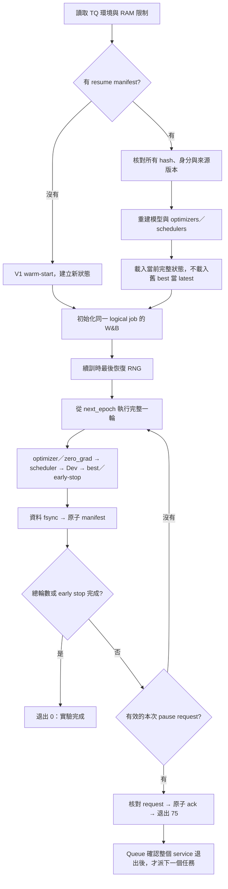

# N3 與 Train Queue：接入與驗收

更新：2026-09-16。**Queue RAM 與「Wav2Vec2 讓位給真實 CRAB urgent」已通過小資料驗收；CRAB 自身暫停／恢復的真實數值對照仍未完成。** 不將 urgent 完整跑完的證據誤當 CRAB own-resume 資格。

## 1. 路徑與範圍

| 項目 | 路徑／決定 |
|---|---|
| Queue 實際專案 | `/home/brant/Project/train_queue`；本機 `/project/train_queue` 不存在 |
| Crab Python | `/home/brant/Project/SAILER_test/Crab/.venv/bin/python`（Python 3.10.20／torch 2.2.0+cu121） |
| Queue Python | Queue 自己的 `.venv`；不混用 Crab 的環境 |
| 新訓練入口 | `bin/train_crab_queue.py` |
| 單任務 wrapper | `bin/run_crab_queue_job.py`，用 `os.execv` 保留退出碼與 queue 所屬 cgroup |
| checkpoint 模組 | `bin/crab_epoch_checkpoint.py` |
| CPU 測試 | `bin/test_crab_epoch_checkpoint.py` |
| 任務範本 | [n3a25-review-only.yaml](n3a25-review-only.yaml)，預設不允許啟動 |

9/15 實作未修改舊 `train_crab_lora.py`、A/B/CL campaign wrappers、frozen campaign 或歷史權重，當時只做 CPU 測試。9/16 另一次 SSAMBA 工程驗收已使用新 CRAB 入口跑小資料 urgent，見下節。這次 Git 整理只提交程式／介接文件，未啟動訓練。

### 本分支發布範圍

包含 N3 多 seed／B runner、B evaluator、CPU 測試及 queue 介接。不包含 NNIME 音檔／逐字稿／校準包、TTS 資料、模型權重、HF cache、frozen campaign 產物、研究暫存文件及 SSAMBA 目錄。歷史 runners 會讀取本機既有 campaign.json；這些資料刻意不發布，乾淨 clone 不是即刻可訓練的資料包。多 seed CPU 測試已改成不含研究資料的 fixture；checkpoint 的 queue 協定相容測試另需本機 Train Queue 專案，可用 TRAIN_QUEUE_ROOT 指定。缺少真實訓練依賴時不要下載或偽造 NNIME 資料來繞過檢查。

## 2. 正確的狀態流程



保存／核對失敗會以其他非零碼退出，不回覆成功暫停。最後一輪或 early stop 優先於暫停，**不是**「完成後再排一次續訓」。不使用 SIGSTOP。

## 3. 完整 checkpoint 內容

每輪建立不可變的新 snapshot，9 個資料檔全部納入 manifest 的大小與 SHA256：

| 檔案 | 內容 |
|---|---|
| `audio.pt`、`text.pt`、`ser.pt` | 當前完整 state_dict：base、adapters、head、persistent buffers |
| `optimizers.pt` | 依 `audio/text/ser` 名稱對應的 AdamW 狀態，包含 moments 與 step |
| `schedulers.pt` | 每個具名 scheduler 的完整狀態 |
| `runtime.pt` | progress、best、early-stop、normalization、RNG、精度、W&B、來源 fingerprint、參數 layout |
| `best_audio.pt`、`best_text.pt`、`best_ser.pt` | 真正最佳 epoch 的完整權重；用 immutable hardlink 保留，不混用 latest head |

`runtime.pt` 保存 completed/next epoch（0-based）、optimizer updates、accumulation steps/pending=0、best metric/epoch、patience/no-improve、Python/NumPy/torch CPU/CUDA RNG、train/dev/sampler generators、W&B ID 與 next logging step。FP32／bf16 autocast 均記錄精度；目前 bf16 沒有 GradScaler，因此 scaler 為 null。共用模組支援 scaler state，但 fp16 不在新入口支援範圍。

內容指紋涵蓋 CLI、Python／套件、backend/TF32/determinism/threads 設定、相關執行環境變數、Crab src 與新入口程式、CSV、Train/Dev WAV、base snapshot、V1 warm-start 及 class weights；每輪保存前再次核對檔案內容。這會增加 I/O，尚未量測真實訓練開銷。

LoRA 的 `adapter_config.json` 常以 `inference_mode=true` 匯出。恢復時明確設回 false，只建結構，最後載入 **current full state**，避免 adapters 凍結。CPU PEFT 測試已涵蓋此情境。

## 4. 與舊實驗的差異及限制

- 舊 `checkpoint_latest.pt` 缺少 optimizer/RNG 等狀態，**不能轉換成真正 resume**；只能 warm-start。
- 保留舊 loss、gradient accumulation、clip、optimizer step 計算；已有文字區塊比對測試。新入口加入獨立 DataLoader generators，因此同 seed 不保證逐筆重現歷史 run；應比較新入口「連續 vs 暫停續訓」。
- 僅支援一張可見 GPU、`num_workers=0`；預設不使用 pin memory。不執行 inline Test、legacy debug 或 smoke 訓練。
- `TQ_OUTPUT_DIR` 必須為新任務專用空目錄；續訓沿用原 output。設定或輸入版本改變即拒絕恢復，不靜默重開新實驗。
- W&B 使用固定 logical-job ID；首次 `resume=never`、恢復 `resume=must`，logging step 單調遞增。支援 online／disabled，offline resume 尚未驗證，直接拒絕。
- 若崩潰前已向 W&B 寫入後續 batch，但只剩較早 checkpoint，remote step 超前時會拒絕靜默倒退；須人工處理。正常 epoch 暫停不同於任意 crash 後的 log rollback。
- `best_model.json` 指向完整 state_dict；**不是舊 API／Test evaluator 的 adapters-only 格式**。正式評測前需另安排格式匯出／reader 驗證，不能直接把新目錄交給舊 evaluator。
- full/partial FT、bf16 數值一致性、多 GPU、非零 workers、跨機器／硬體恢復均未取得真實驗收；目前主要目標為 N3 單卡 FP32 LoRA。

## 5. RAM、磁碟及 Queue 現況

新入口在 heavy stack／模型載入前檢查目前 cgroup。不得以另建巢狀獨立 systemd service 逃離 queue 的程序管理。

| N3 任務要求 | 值 |
|---|---|
| MemoryHigh | 建議 16 GiB；不得超過 16 GiB 或 MemoryMax |
| MemoryMax | 建議 20 GiB；必须有限且不超過 20 GiB |
| MemorySwapMax | 0 |
| OOMPolicy／memory.oom.group | kill／1 |
| 主機 MemAvailable | 啟動至少 32 GiB；途中至少 12 GiB |
| 本任務 memory.current | 達 19 GiB 或更小的 MemoryMax 時安全報錯 |
| 建議 CPU／子程序限制 | CPUQuota 200%、TasksMax 128、OMP/MKL/OPENBLAS threads=1 |

9/16 已核對 queue 增加 per-job `resources`，涵蓋 `memory_high_mb`、`memory_max_mb`、`memory_swap_max_mb`、`oom_policy`、`memory_oom_group`、`cpu_quota_percent`、`tasks_max`；明確指定時七欄位均必填，變更會影響 frozen fingerprint。省略 resources 的舊 job 維持既有 fingerprint 並使用 16/20 GiB 保護預設。實際 systemd／子程序 cgroup、OOM 整組退出及 API 重啟測試已通過；不需要再次實作或關閉 Crab RAM guard。

本次以本機 `SSAMBA/resources/queue_real_acceptance_20260916.json` 核對 queue 6 個相關來源檔案 SHA256，全部相符。這是內部驗收證據位置，不隨本 Crab 分支發布。小資料實測為 Wav2Vec2 完成 epoch 1、退出75 → CRAB 48 Train／18 Dev、2 epochs、6 updates、退出0 → Wav2Vec2 自動完成 epoch 2–3，恢復後與連續路徑精確相等。CRAB `pause_mode=none`，沒有做自身暫停。不得據此放行所有 SSAMBA arms 或宣称 CRAB resume 已驗收。CRAB 觀察到的 cgroup RAM peak 約14.94 GiB，不代表全量資料峰值保證。

完整 snapshot 遠大於舊 adapters-only：估算每輪 = `1.2 × (所有 model tensor bytes + Adam moments 約 8 × trainable params) + 64 MiB`。啟動與每輪保存前，按剩餘輪數加 20 GiB 磁碟保留量檢查；N3 預期為每輪數 GiB，**尚未以真實模型量測**。不自動刪除任何 snapshot／舊實驗；hardlink 的 best 不額外複製內容，但 manifest 仍完整驗證。磁碟同時有其他下載／任務，啟動前應再檢查。

## 6. 已完成的 CPU 驗證

2026-09-15：**40/40 通過，0 skipped**。Python 3.10.20、torch 2.2.0+cu121；GPU 隱藏、W&B mocked/disabled、無 forward/backward/optimizer.step。使用小型 Linear／PEFT 模型與人工填入的 optimizer fixture；不是 N3 真實訓練。

| 測試群 | 覆蓋 |
|---|---|
| State round-trip | current 模型/buffers、具名 opts/schedulers、progress、norm；dict 順序變更仍對應正確 |
| LoRA／precision | 恢復後 adapters 仍可訓練；bf16 無 scaler 格式；精度與參數 layout 改變拒絕 |
| RNG／程序 | Python、NumPy、torch、下一輪 shuffle／weighted sampler；新 Python 程序讀取 snapshot |
| checkpoint 安全 | checksum、缺檔、缺 optimizer 內部狀態、path escape、symlink、錯 job／fingerprint |
| 失敗處理 | torch.save、fsync、manifest rename、ack 寫入失敗不得成功暫停 |
| 退出／排程協定 | manual/preempt→75；無 pause 繼續；完成/early-stop→0；過期 request 拒絕 |
| Queue 相容性 | 用朋友現有 `protocol.py` 實際驗證 manifest、ack 及 latest checkpoint |
| Wrapper／logging | 實際子程序 exec 保留75；環境不被覆寫；W&B同ID／must resume及step超前拒絕 |
| 資源與回歸 | RAM／磁碟拒絕條件、資料夾隔離、舊 loss／optimizer step 區塊一致 |

另兩個 CLI `--help` 通過；真實受限 cgroup `memory.max=4G/high=3G/swap=0/oom.group=1` 通過安全檢查。CPU 測試 parent 的 ru_maxrss 約 505 MiB，不能視為真實 N3 RAM 需求或整個 cgroup peak。

朋友 queue 的既有 `scripts/check.py` 也已重跑：Ruff 通過、29/29 CPU 模擬測試通過（25.74 秒，兩項上游棄用警告）。只建立獨立 `.test-artifacts`，未啟動正式服務／正式任務；未修改 queue 原始碼。這些不是實際 N3 訓練測試。

任務 YAML 已通過朋友目前 `JobSpec` schema；`urgent=true`、`pause_mode=none`。執行預設 gate 實測退出 64，沒有啟動 trainer。`git diff --check` 通過。

測試證據保存在 local-only `experiments/queue_acceptance_20260915/cpu_tests.json` 與 `preflight.json`，包含程式 SHA256。重跑方式（unit 名稱每次用新名稱）：

```bash
systemd-run --user --wait --pipe --collect \
  -p MemoryMax=4G -p MemoryHigh=3G -p MemorySwapMax=0 -p OOMPolicy=kill \
  -p CPUQuota=200% -p TasksMax=128 \
  /usr/bin/env CUDA_VISIBLE_DEVICES= OMP_NUM_THREADS=1 OPENBLAS_NUM_THREADS=1 MKL_NUM_THREADS=1 \
  HF_HUB_OFFLINE=1 TRANSFORMERS_OFFLINE=1 WANDB_MODE=disabled PYTHONDONTWRITEBYTECODE=1 \
  /home/brant/Project/SAILER_test/Crab/.venv/bin/python -B \
  /home/brant/Project/SAILER_test/Crab/bin/test_crab_epoch_checkpoint.py
```

## 7. 正式啟用前的驗收門檻

1. Queue per-job RAM 限制與真實 service CPU probe 已通過；部署時仍需核對使用相同已驗證版本及 resources。不要修改正式資料庫來做測試。
2. 另行獲准後，在獨立小資料與新 output，用相同 N3 模型、V1、loss、FP32、LoRA、accumulation 做「連續 N 輪」對照「K 輪後退出75、重建程序、完成N輪」。目前未安排、未執行。
3. 比較 current/best 參數、每個 optimizer moments/step、scheduler/LR、更新數、下一輪樣本順序、norm、best/early-stop、W&B ID/step；先定義 deterministic 或數值誤差門檻。
4. 真實 queue 的人工 pause、普通工作讓位→urgent完成→自動resume、最後一輪與early-stop遇pause，以及損毀／中斷情境；確認所有子程序退出與 GPU 記憶體釋放。
5. 通過後才把 `pause_mode` 改成 `epoch_v1`、移除範本的禁止啟動 gate。畢專新工作 `urgent: true`；急件彼此 FIFO，不會打斷另一個急件。現有普通任務若不支援 epoch_v1，只能等它正常完成。
6. 9/16 其他授權工作已將 user linger 改為 yes；但全部登出後至少30秒零 session 的持續性觀察仍未完成，不能單憑 Linger 保證。這次 Git 整理不修改系統設定。

## 8. 9/16 公開分支提交前檢查

在隔離 worktree 執行多 seed runner、B runner、B evaluator、完整 checkpoint 四組 CPU 測試，共 **75/75 通過**。初次發現多 seed 測試依賴未發布的 campaign.json，已改為公開安全 fixture 後重跑通過，未複製真實資料進 Git。任務範本通過目前 queue JobSpec 的 resources 驗證，預設 gate 實測退出64。測試限制4 GiB RAM、GPU停用，沒有訓練。

結論：本文件代表 **Crab 模型端 CPU-ready**，不是 production-ready，也不是現有歷史 run 可直接接續。
