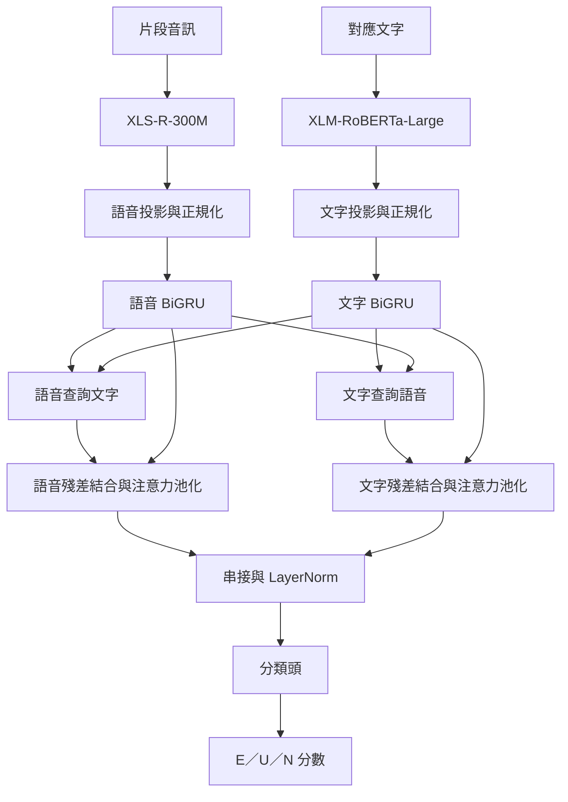
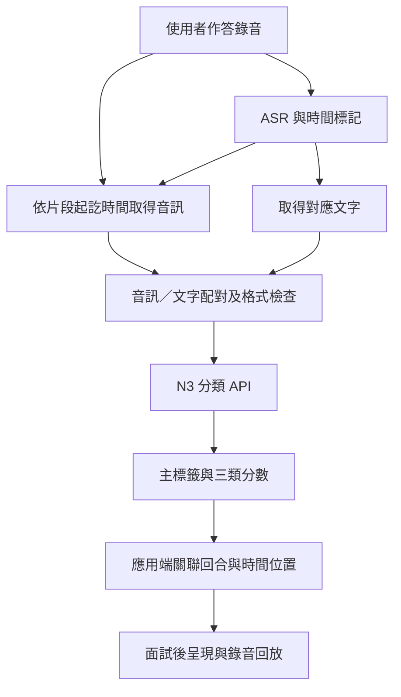

# 第二章　情緒辨識機制

正文初稿 v0.1｜2026-09-17｜供指導老師審閱，非最終定稿

> 編輯說明：本稿依[章節架構](CHAPTER_2_EMOTION_RECOGNITION_OUTLINE.md)與[素材清單](EMOTION_RECOGNITION_MATERIALS_INVENTORY.md)撰寫。標示「企劃書原文」的段落保留原句，只合併 PDF 排版斷行；其餘為新增正文。原文中的歷史數字、研究解釋與介面描述不自動代表現況。以「待核對」標示的文字是編輯註記，定稿時須完成核對後處理。
>
> 實驗摘要依現有結果文件截至 2026-09-14 的紀錄；本次未重新訓練或評估。API 描述依本機 N3 API 文件，不代表已完成正式系統的全部驗收。圖表編號暫訂；本稿以方法章為主，完整結果表預留至全書的「實驗結果與討論」章。

## 本章架構

- 2.1 辨識任務與系統需求
- 2.2 相關方法比較與選用理由
- 2.3 資料來源、標籤定義與前處理
- 2.4 雙模態模型架構與中文適配
- 2.5 訓練策略與實驗設計
- 2.6 推論流程與系統整合
- 2.7 辨識結果彙整與面試回饋
- 2.8 方法限制與適用條件

本章說明面試練習系統之情緒辨識機制，從任務定義、資料處理、模型設計與訓練方法，延伸至服務推論及結果呈現。系統以台灣華語面試練習為主要應用情境，使用作答語音與對應文字共同進行分類，提供使用者回顧表達方式的輔助資訊。本專題採用既有 Crab 架構，主要工作包含中文編碼器適配、資料標籤整理、兩階段微調、合成語料擴增實驗，以及情緒辨識服務之實作；並非從零提出 Crab 架構。

## 2.1　辨識任務與系統需求

### 2.1.1　面試練習的情緒資訊需求

面試練習除了回答內容，也涉及作答時的語音表達。本系統因此將情緒辨識與面試內容評估分開處理：前者描述語音及文字片段的分類結果，後者則由面試流程中的其他模組處理。此分工使情緒訊號可以作為回聽與練習的線索，而不直接取代回答品質、專業能力或錄取適任性的判斷。

企劃書原文 P01（PDF 第 1 頁）：

> 本模組架構採用 Crab 模型 [1]，由本團隊自行訓練權重並部署為本地端服務。系統對每一則回答進行逐句切分後輸出三類面試情緒（興奮／不自信／中性），藉此定位使用者自哪一句起展現不自信。相較於將整段回答歸納為單一標籤的作法，逐句判讀得以保留段內的情緒變化。

上述段落描述原企劃書的逐句回饋設計。本章在技術上以「語音及其對應文字片段」作為辨識單位：只有當音訊切點與文字句段完成對齊時，片段結果才能進一步對應為逐句結果。固定秒數窗口與完整語意句並非同一概念，因此不能僅由模型提供片段分類，就推定系統已具備精確的逐句定位能力。

> 待核對：正式面試後端目前採用的 ASR 句段、切點與時間標記流程，應由整合負責人確認後補入 2.6。

### 2.1.2　三類任務與輸入、輸出

本專題將分類目標定義為興奮（Excited，E）、不自信（Unconfident，U）及中性（Neutral_3Class，N）。其中「不自信」是本專題為面試練習建立的操作型標籤，來自原始情緒標籤的映射與合成資料的指定目標，並不是透過心理量表取得的自信程度真值。

**表 2-1　辨識任務的輸入、輸出與責任邊界**

| 項目 | 本專題定義 |
|---|---|
| 主要服務情境 | 台灣華語面試練習 |
| 模型輸入 | 使用者作答音訊，以及對應相同片段的文字 |
| 分類單位 | 單一對齊片段，不直接等同整場面試 |
| 分類輸出 | E／U／N 主標籤、三類 softmax 分數及主類別分數 |
| 追溯資訊 | 模型版本、輸入模式、音訊長度與處理時間等 |
| 應用端責任 | 將結果關聯至回答、時間位置、逐字稿及回放入口 |
| 不屬於模型輸出 | 人格、心理診斷、誠實程度、錄取機率或面試能力分數 |

### 2.1.3　情緒辨識與能力評分的界線

模型輸出的 `primary_confidence` 表示主預測類別的分數，不是使用者本身的「自信程度」，也不能在未校準的情況下直接視為預測正確率。因此，本章將辨識結果定位為輔助練習資訊，強調保留原音訊與文字供回顧，避免只顯示一個標籤便對使用者作整體評價。英文 Scheme 1 模型可作為研究演進背景，但本章以中文 N3 為主，不混合報告不同語言及資料集的分數。

## 2.2　相關方法比較與選用理由

### 2.2.1　辨識方法的比較面向

就本系統可取得的輸入而言，方法選擇可分為文字、語音與雙模態三種方向。文字提供回答的語意內容，語音則保留文字未直接呈現的聲學資訊。雙模態設計的目的，是讓模型同時使用這兩種輸入；但是否優於單模態仍須以相同資料與評估條件的對照實驗判定，不能只由架構複雜度推論。

**表 2-2　方法選用的設計考量**

| 方法方向 | 主要輸入 | 可利用的資訊 | 本系統需考量的限制 |
|---|---|---|---|
| 文字分類 | 逐字稿 | 詞彙及上下文 | 沒有直接使用聲學表達，且受逐字稿正確性影響 |
| 語音分類 | 音訊 | 聲學與時間序列資訊 | 需驗證語言、口音、錄音條件及領域差異 |
| 語音＋文字融合 | 音訊及逐字稿 | 兩側表徵及其交互關係 | 需要片段對齊、兩個編碼器及額外整合流程 |

本表為方法特性與設計考量，不是本專題已完成的單模態／雙模態效能排行榜。

### 2.2.2　Crab 的選用背景

企劃書原文 P02（PDF 第 5 頁）：

> 本系統情緒辨識模組之模型架構採用已發表之 Crab 模型 [1]。
>
> 在技術調研時（2026 年 3 月）比較各語音情緒辨識模型在 MSP-Podcast 上之表現，Crab 為當時該資料集上成績最佳者。

本專題以 Crab 作為實作起點，保留語音與文字的融合架構，再針對中文應用調整編碼器與訓練資料。此路線讓研究問題集中於「既有架構如何適配本系統」，而不是同時更換整個融合架構及資料定義，增加比較上的不確定性。

> 待核對：P02「成績最佳」為原企劃書的歷史主張，定稿需補比較來源、指標、split 及時間；本初稿未重新查核排行榜。

### 2.2.3　中文適配需求

企劃書原文 P03（PDF 第 4 頁）：

> Crab [1] 原研究之三個評測資料集皆為英文語料，其語音與文字編碼器(encoder)亦僅在英文條件下驗證。文字側與語音側所採用的 RoBERTa 和 WavLM 直接套用於中文面試語音時，能力明顯不足。實測顯示，以原架構之編碼器(encoder)組合在相同中文語料上訓練後，『不自信』 F1 僅 0.320，為三類中最低，而該類正是面試回饋中最需要準確判讀的目標。

基於中文服務需求，本專題後續採取跨語言編碼器替換與中文資料微調。除了總體 macro-F1，也持續追蹤 U 類 precision、recall 與 F1，檢視模型是否漏掉目標片段，或把原本中性的回答過度判為 U。這兩種錯誤在面試練習介面上具有不同影響，不能僅由整體分數反映。

> 待核對：P03 的 0.320 需回查原始 run 及 split；本稿不將它與不同條件的歷史數字串成已證明的單一路線改善幅度。

## 2.3　資料來源、標籤定義與前處理

### 2.3.1　真人資料來源與實際使用量

本研究的主要資料來源為 MSP-Podcast、EmotionTalk 與 NNIME。資料庫的原始規模、映射後可用規模，以及某次訓練實際使用量是不同概念，因此本節分別保留資料來源介紹，並列出 N3 訓練路線所使用的資料數量。

企劃書原文 P04（PDF 第 2 頁）：

> MSP-Podcast [2] 為本作品英文情緒模型之訓練語料。該研究提出自既有 Podcast 錄音中檢索情緒語音以建構大規模語料庫的方法，樣本取自真實對話而非演員表演，情緒分布亦較為均衡，適用於面試此類非表演性語音之判讀情境。
>
> NNIME [3] 為本作品中文情緒模型之訓練語料。該語料庫收錄 44 位受試者之即興雙人互動，同步記錄語音、影像與生理訊號，為中文自然互動情緒研究之重要資源，亦為少數具備足夠規模之繁體中文情境語料。
>
> EmotionTalk [4] 為本作品中文情緒模型之訓練語料。該語料庫收錄 19 位受試者之雙人互動，共 23.6 小時、19,250 句，同步提供聲學、影像與文字三種模態，並具備七類情緒、五級情感傾向與四維語音描述等多層次標註。

上述為原企劃書的來源描述；本模型實際使用音訊與文字，不因資料庫另提供影像或生理訊號，就代表本專題也使用那些模態。資料集的互動情境也不能直接替代台灣華語面試情境的驗證。

**表 2-3　N3 路線使用的真人資料**

| 階段 | 資料來源 | 本階段訓練筆數 | 用途 |
|---|---|---:|---|
| V1 雙語骨幹 | MSP-Podcast | 30,000 | 英文資料來源 |
| V1 雙語骨幹 | EmotionTalk | 11,744 | 中文資料來源 |
| V1 合計 | 上述兩者 | 41,744 | 建立後續共同初始化權重 |
| N3 stage 2 | NNIME Train | 3,054 | 中文適配；後續依實驗加入 TTS |

N3 stage 2 的真人 Development（以下簡稱 Dev）及 Test 分別為 608 與 638 筆，皆不加入 TTS。本階段不再將 V1 的 41,744 筆資料混入訓練。其他歷史混合資料版本曾包含不同資料來源，不能以其總量替代表 2-3。

> 待補：正式版本應附各資料來源之版本識別、逐 split 使用量與授權說明；原文資料庫規模及敘述仍待文獻校對。

### 2.3.2　三類映射與類別分布

企劃書原文 P05（PDF 第 5 頁）：

> 三類面試情緒: 原始語料採用八類通用情緒標註，其分類目的為描述一般情感狀態，與面試回饋所需的判讀維度並不一致。在內部討論以及調研後，將八類標註映射為三類面試情緒：興奮、不自信、中性，使模型輸出可直接對應面試者的表現特徵，並同時緩解原始語料中少數類別樣本過少的問題。

實際資料整理須依各資料集的標註體系分別處理，不能將上述八類描述套用到所有資料集。以 NNIME 為例，本專題使用細粒度評分者標籤映射，而不是直接將音檔名稱中的情境類別當作逐句情緒真值。建置程式將評分者標籤分至 E／U／N 或排除集合，再依票數及排除規則產生三類標籤。

**表 2-4　NNIME 映射示例與真人 Train 分布**

| 目標類別 | 現行映射中的原始標籤示例 | Train 筆數 | Train 比例 |
|---|---|---:|---:|
| E 興奮 | 快樂、喜樂、興奮、驚訝、期待、自信等 | 808 | 26.46% |
| U 不自信 | 恐懼、緊張、焦慮、傷心、失望、尷尬、挫折、疑惑等 | 628 | 20.56% |
| N 中性 | 中性、放鬆、祥和、認真、嚴肅、其他 | 1,618 | 52.98% |
| 合計 | 映射後納入的真人訓練片段 | 3,054 | 100.00% |

表中原始標籤僅為示例，完整集合與票數處理以建置程式為準。部分悲傷、緊張或疑惑標籤被合併至 U，不代表這些情緒在心理學上等同於不自信。三類映射擴大了每類內部涵蓋的情緒範圍，也帶來解讀上的限制。定稿時需補 MSP-Podcast、EmotionTalk 的逐資料集映射表與各 split 分布，不能由 NNIME 的映射規則推定其他來源。

### 2.3.3　前處理與評估資料隔離

訓練端將音訊轉為模型所需的 16 kHz 輸入，使用最長前 12 秒的音訊與最多 128 tokens 的文字。各組依其 Train 資料計算正規化統計，並保存供該模型的 Dev、Test 使用，避免以評估資料重新估計統計量。由於加入 TTS 後各組 Train 內容不同，「採相同正規化演算法」不代表所有組別使用相同的 mean／std。

真人 Train、Dev 與 Test 在本輪消融中保持固定；合成音訊全部指定為 Train。選模使用 Dev macro-F1，Test 則另行評估。此設計讓測試對象維持為真人資料，而不是以合成測試資料衡量合成訓練資料的效果。

訓練時的截長規則與 API 的請求限制亦應分開：現有 API 對單筆超過 12 秒或文字超過模型 token 上限的輸入採明確拒絕，不能在報告中概括為「所有服務輸入均自動截斷」。

### 2.3.4　面試情境 TTS 與時長匹配

為探索補充 U 類資料的影響，本專題以面試相關回答建立 TTS 訓練候選，並採兩種音訊版本比較。

- **A 組 Long12**：使用不超過 12 秒、尚未匹配 NNIME 時長分布的長片段。候選庫來自 500 個原始回答，經複製、去首尾靜音或切分後產生 576 支衍生音檔。因此 A 組不宜統稱為「完全未裁切的原始完整音訊」。
- **B 組 Match-min1**：以與 A 對應的來源回答及 Long12 子片段為基礎，依 NNIME Train U 中至少 1 秒的資料建立時長匹配候選，優先使用標點、停頓或既有 ASR token 時間邊界。

NNIME Train U 共 628 筆，其中 510 筆至少 1 秒，另 118 筆短於 1 秒。Match-min1 只將前者作為合成目標分布，並未刪除真人 Train 中短於 1 秒的資料。最終建立的 B 候選共 471 支，三組採 157⊂314⊂471 的巢狀集合；各劑量每個原始回答最多選一段，避免把同一回答切出的多段直接當作獨立來源增加筆數。

**表 2-5　U 類 TTS 的新增量與訓練組成（A／B 各自適用）**

| 劑量 | 新增 U TTS | E | U 合計 | N | Train 合計 | TTS 占 Train 筆數 |
|---|---:|---:|---:|---:|---:|---:|
| 0% 歷史 N3 | 0 | 808 | 628 | 1,618 | 3,054 | 0% |
| 25% | 157 | 808 | 785 | 1,618 | 3,211 | 4.89% |
| 50% | 314 | 808 | 942 | 1,618 | 3,368 | 9.32% |
| 75% | 471 | 808 | 1,099 | 1,618 | 3,525 | 13.36% |

新增劑量以真人 Train 的 U=628 為分母，而不是全部真人資料量，也不是 TTS 在混合資料中的占比。本輪只改變 U 類新增量，沒有強制整體類別比例成為 4：4：3。筆數比例與音訊總時長比例也不同，因此比較資料量時，仍需同時保留時長統計。

本批合成資料的 U 標籤來自生成意圖，全部仍未完成情緒、逐字稿及台灣華語自然度的人工驗收。自動檢查已處理來源、格式與分布等項目，但不能證明語音確實表達 U。生成聲線亦集中於同一聲線；500 個原始回答並不代表 500 位說話者。因此，本輪結果定位為探索性擴增實驗，而非經人工標註驗證的新情緒資料庫。

## 2.4　雙模態模型架構與中文適配

### 2.4.1　語音與文字編碼器

企劃書原文 P06（PDF 第 4 頁）：

> 編碼器(encoder)跨語言替換: 語音側改用 wav2vec2-XLS-R-300M、文字側改用 XLM-RoBERTa-Large，取代原架構之 WavLM 與 RoBERTa，提升模型在中文的辨識能力。

在中文 N3 配置中，語音與文字分別經過各自的預訓練編碼器，形成後續融合所需的序列表徵。兩側輸入必須描述相同片段，避免以短音訊搭配整段回答文字，造成模型接收不一致的上下文。

### 2.4.2　時序建模與跨模態融合

企劃書原文 P07（PDF 第 5–6 頁）：

> 跨模態融合部分維持原架構設計：語音與文字兩側各經線性投影與雙向 GRU 建模時序後，以跨模態注意力雙向對齊（語音查詢文字、文字查詢語音），殘差相加、注意力池化、串接後進分類頭。

線性投影用於將兩側特徵轉至融合所需的維度；雙向 GRU 處理各自的序列關係。其後，語音表徵以文字表徵作為注意力的參考，文字側亦反向使用語音資訊。兩側各自完成殘差結合與注意力池化，再串接為分類輸入。此處的跨模態注意力是特徵交互機制，不等於服務端的逐字時間對齊，兩者仍須分別處理。

**圖 2-1　中文雙模態模型流程示意（依本機實作整理）**



本圖為正文初稿的流程示意，未改動企劃書原圖。正式排版可沿用企劃書圖 1，或將本圖製成正式版本；均須註明源自 Crab 架構及本組的編碼器替換，避免將既有方法列為本組原創。

### 2.4.3　LoRA 與多層對比監督

本專題採 LoRA 微調語音與文字編碼器，並訓練融合分類部分。此方式不同於從零訓練整個基礎模型；模型初始化、可訓練部分與學習率需在配置中分別記錄。中文實驗的 LoRA rank 為 16、alpha 為 32、dropout 為 0.1，語音側與文字側皆有適配，不是將整個語音編碼器完全凍結。

企劃書原文 P08（PDF 第 2 頁）：

> Crab [1] 為雙模態跨模態 Transformer 架構，核心是多層對比監督：在網路的多個層次注入對比學習訊號，而非只在最後的分類層施加監督，藉此提升中間表徵的鑑別力，且推論時不增加參數。

本機實作在語音、文字及融合等不同層次建立對比監督，並與分類損失共同訓練。此監督用於學習階段，推論分類不需要提供真實情緒標籤。原文「推論時不增加參數」應限定於該監督機制的推論使用方式，不代表中文模型、LoRA 適配或整個服務完全沒有額外資源成本。

> 待補：正式稿需補上 XLS-R、XLM-R 與 LoRA 的原始文獻；本稿先不新增未查證的書目資訊。

## 2.5　訓練策略與實驗設計

### 2.5.1　V1 與 N3 的兩階段訓練

企劃書原文 P09（PDF 第 5 頁）：

> 兩階段遷移訓練: 先於中英混合語料上建立雙語骨幹，再以 NNIME [3]完成第二階段微調。實測顯示中英混合訓練所得之骨幹，效能優於以更大量純英文資料訓練者，跨語言混合訓練於此具有正則化的作用。

本專題以 V1 稱呼此路線的雙語骨幹，N3 則是由 V1 初始化並以 NNIME 進行第二階段微調的中文模型版本。stage 2 表示訓練階段，不是另一個獨立的基礎模型名稱。後續 A、CL 與 B 各組皆從同一 V1 權重獨立載入，重新建立 optimizer，不是前一組訓練完後接著訓練下一組。

**圖 2-2　共同初始化與獨立微調的關係**

```text
MSP-Podcast 30,000＋EmotionTalk 11,744
                    ↓
              V1 雙語骨幹
                    │ 相同初始化權重
                    ├─ 原 N3：NNIME 真人 Train
                    ├─ A：NNIME＋Long12 U TTS
                    ├─ CL：固定 A25 資料，改變 stage 2 對比損失權重
                    └─ B：NNIME＋Match-min1 U TTS

各分支獨立微調；不相互續訓。Dev／Test 均為固定真人資料。
```

> 待核對：P09 將改善解釋為正則化作用，是原企劃書的研究解釋。效能差異本身尚不足以單獨確立此原因，定稿需補對照證據，或另經確認後修訂為假說。

### 2.5.2　損失函數與共同配置

本輪第二階段訓練結合類別加權交叉熵與多層對比損失，可概括為：

$$
\mathcal{L}=\mathcal{L}_{\mathrm{weighted\ CE}}
 +\lambda\left(\frac{1}{5}\sum_{j=1}^{5}\mathcal{L}_{\mathrm{CL},j}\right).
$$

五項對比監督分別來自語音 frame 表徵、文字 frame 表徵、語音池化表徵、文字池化表徵及融合表徵；其中 frame 名稱沿用實作命名，不表示逐音框具有人工情緒標籤。λ 控制這些監督相對於分類損失的權重。CL0 只取消本次 stage 2 的對比損失，不會消除初始化權重在 V1 階段的訓練歷史。

**表 2-6　N3 後續消融的共同核心配置**

| 項目 | 配置 |
|---|---|
| 語音／文字骨幹 | XLS-R-300M／XLM-RoBERTa-Large |
| 初始化 | 同一 V1 的兩側 LoRA 與 SER head |
| LoRA | rank 16、alpha 32、dropout 0.1 |
| 學習率 | Head 5×10⁻⁵；Encoder LoRA 2×10⁻⁵ |
| Optimizer／scheduler | AdamW；每 epoch 使用 CosineAnnealingLR，T_max=10 |
| 批次 | micro-batch 4；gradient accumulation 4 |
| CE 權重 | E=1.2599、U=1.6210、N=0.6292；加入 TTS 後不重算 |
| Fusion hidden／dropout | 512／0.5 |
| Gradient clipping | 1.0 |
| 計算精度 | FP32；不啟用 AMP |
| 音訊／文字上限 | 16 kHz、前 12 秒；128 tokens |
| 最佳權重 | 各 run 的最佳 Dev macro-F1 checkpoint |

梯度累積使名義更新批次為 16，但每次對比損失仍以 micro-batch 的 4 筆計算，不能視為同時對比 16 筆。不同劑量雖可固定 epochs，因 Train 筆數增加，optimizer 更新次數仍會不同；本輪是固定 epochs 的資料劑量比較，不是固定更新次數的比較。

### 2.5.3　消融問題與控制變因

**表 2-7　已執行的 N3 TTS 實驗設計**

| 實驗 | 研究問題 | 配置差異 | 訓練次數 | 評估狀態 |
|---|---|---|---:|---|
| 歷史 A | 新增 U 的劑量如何影響辨識？ | Long12 25／50／75%；seed42；CL2 | 3 | Dev、Test |
| CL | 目前中文資料是否需要對比監督？ | 固定 A25；λ=0／1／2／3；seed42 | 4 | Dev |
| 新 A 多 seed | 劑量比較是否受訓練隨機性影響？ | 三劑量×seeds42／43／44；CL2 | 9 | Dev |
| B | 時長匹配建集策略是否改善結果？ | 與 A 對應來源及筆數；Match-min1；seed42；CL2 | 3 | Dev、Test |

歷史 A 與 CL 最多訓練 10 輪，patience 為 5；新 A 多 seed 與 B 則均跑滿 10 輪、不啟用 early stopping。關閉 early stopping 不代表使用最後一輪權重，仍以 Dev 最佳 checkpoint 進行報告或後續 Test。比較 B 與 A 時，本稿使用同劑量、新 A full10、seed42 作為 Dev 對照，不混用歷史 A 或 A 的三 seed 平均。

時長匹配同時改變音訊內容、文字片段，以及由各組 Train 計算的正規化統計，因此 A/B 所比較的是兩種建集策略，不能將所有差異單獨歸因於「秒數變短」。興奮或中性 TTS 擴增尚屬後續方向，不列為本表已完成的實驗。

### 2.5.4　評估指標與選模原則

本研究以 macro-F1 作為主要指標，將 E、U、N 三類 F1 等權平均：

$$
F1_c=\frac{2TP_c}{2TP_c+FP_c+FN_c},\qquad
\mathrm{Macro\text{-}F1}=\frac{F1_E+F1_U+F1_N}{3}.
$$

此指標使三類在總分中具有相同權重，但仍須搭配各類 precision、recall、UAR 及混淆矩陣解讀。以 U 為例，precision 上升而 recall 下降，表示被預測為 U 的片段較準確，卻可能漏掉更多真正的 U；不應僅選擇有利的一個指標報告。

Dev 用於選擇各 run 的 checkpoint 及比較配置，Test 作為另行執行的保留評估，不以 Test 排名回頭更換最佳 epoch。多 seed 報告平均、樣本標準差及各次結果，不挑單次最高值代表整組。Test 曾多次用於觀察不同配置的結果，也會增加後續研究決策接觸測試資訊的風險；正式結論應保留評估歷程，並考慮另以未參與開發的新資料驗證。

### 2.5.5　階段性結果摘要

企劃書原文 P10（PDF 第 5 頁，8 月歷史結果）：

> 目前中文模型於 NNIME 測試集之 macro-F1 達 0.5877。三類之中以「不自信」改善幅度最大，F1 自 0.403 提升至 0.482。後續將持續提升模型在臺灣口音上的情緒辨識能力。

這裡的「目前」指 8 月企劃書當時，保留作歷史紀錄。後續實驗已完成 19 個新微調 run，另有包含原 N3 在內共 7 組 checkpoint 的獨立 Test 評估。下表只呈現階段性觀察，完整逐類分數與原始證據由結果章整理。

**表 2-8　截至 2026-09-14 的階段性觀察**

| 比較範圍 | 現有觀察 | 解讀界線 |
|---|---|---|
| 原 N3 回歸 | NNIME Test macro-F1 58.77% | 重現既有模型評估，不等於新環境重新訓練的 0% TTS 對照 |
| 歷史 A | A25 Dev 55.05% 為三劑量最高；其 Test 為 59.25% | 依 Dev 選模；A75 Test 59.67% 僅作事後描述 |
| CL 單 seed | CL2 Dev 55.93%，CL3 55.64% | 相差 0.29 百分點，未證明穩定最佳 λ；尚無此批 Test |
| 新 A 三 seed | A75 Dev 平均 55.91%，樣本標準差 0.13 百分點 | 本批平均較高且變異較小，只有三次；尚無此批 Test |
| B 配對 Dev | B25／50／75 相對新 A seed42 為 −2.94／−0.34／+0.18 百分點 | 沒有時長匹配一致優於 Long12 的證據 |
| B Test | B25／50／75 為 60.73%／58.11%／60.84% | 新 A 尚缺配對 Test，不以此認定 B 穩定優於 A |

截至此紀錄，本實驗線尚未達到 macro-F1 65% 的目標。現有結果顯示資料量、類別取捨與訓練隨機性均需要納入解讀；不能概括為「TTS 越多越好」，也不能由單 seed 結果判定短片段一定無效。尤其未完成人工驗收，使生成標籤與實際可辨識情緒是否一致，仍是需要補足的證據。

## 2.6　推論流程與系統整合

### 2.6.1　由作答錄音至片段輸入

系統整合的目標是將使用者作答錄音轉為帶時間位置的逐字稿，再建立音訊與文字一致的片段，交付 N3 API。時間位置及回合關聯由應用端保留，以便將分類結果放回原始回答。圖 2-3 為整合流程初稿，其中 ASR、對齊與回饋頁仍需依正式後端確認；不能將此圖視為全部功能已驗收的證明。

**圖 2-3　情緒辨識與面試系統整合流程（待整合核對）**



### 2.6.2　API 服務與輸出契約

現有 API 文件標示模型為 `n3-v1-warmstart-nnime-lora-stage2`，提供單筆、批次與長音訊入口。批次介面在內部逐筆執行 forward，以維持與既有 batch-size-one 評估一致的處理方式；「批次請求」不代表多筆同時平行進入 GPU 模型。

**表 2-9　推論服務的主要契約**

| 項目 | 現有規格或責任 |
|---|---|
| 單筆／batch 片段 | 每筆音訊不超過 12 秒；batch 最多 16 筆 |
| 模型文字輸入 | 最多 128 XLM-R tokens，並非 128 個中文字 |
| 過長單筆或文字 | 明確拒絕，不靜默截斷 |
| 長音訊入口 | 以 sliding windows 處理；不等同語意逐句切分 |
| 主分類欄位 | `primary_label`、`primary_confidence`、三類機率分數 |
| 追溯欄位 | 模型身分、輸入模式、音訊長度及時間量測 |
| 時間關聯與回放 | 由應用端依實際片段來源對應；需整合確認 |

### 2.6.3　錯誤處理與驗證邊界

現有服務設計包含單 GPU 序列執行、有限等待佇列、timeout 及資源限制。Caller 應處理輸入拒絕、服務逾時或無法使用等情況，不將失敗片段默認為中性，也不在短片段批次失敗後，直接把超過 12 秒的完整音訊送至單筆入口。

依目前 API 文件，本機 CUDA／HTTP 及 A4500 本機整合已有通過紀錄，正式分支整合與重啟恢復仍列待完成。離線 NNIME 評估使用資料集逐字稿，與線上 ASR 逐字稿的條件不同，因此不能把離線 F1 直接當成整個面試系統的端到端準確度。服務效能亦應另外報告實測硬體、音訊長度、併發條件與延遲，不由訓練速度推估。

## 2.7　辨識結果彙整與面試回饋

### 2.7.1　回饋時機與呈現層級

企劃書原文 P11（PDF 第 1 頁）：

> 本系統不在模擬面試期間顯示即時分數與評語，刻意限縮資訊揭露，使互動回歸「僅有使用者與面試官對談」之真實條件；所有評估資訊統一保留至面試結束後之檢討階段呈現。

企劃書原文 P12（PDF 第 6 頁）：

> 成果報告將各項評分指標清晰分隔，並搭配互動式走勢圖設計。使用者無需頻繁翻頁，只需在固定視窗中透過最少的滑鼠操作，就能輕鬆掌握最全面、最精準的自我表現數據。

上述為原企劃書的介面設計描述，其中「最精準」不是模型準確度的實驗結論。本稿延續面試後回顧的方向，將情緒呈現分為片段、單次回答與整場面試三層，並保留使用者回聽原片段的能力。以下為回饋規則初案，尚待與正式介面確認，不宣稱各項已全部實作。

**表 2-10　結果呈現與彙整原則初案**

| 層級 | 顯示內容 | 必須交代的規則 |
|---|---|---|
| 片段 | 預測類別、原句、時間位置、回放入口 | 語音與文字需對應；不得把分類分數稱為心理自信分數 |
| 單次回答 | 片段時間軸、分布或摘要 | 依筆數、有效時長或平均機率彙整須明確區分 |
| 整場面試 | 各回合變化與內容評語並列 | 回答長度不一、重疊窗口與失敗片段的處理須一致 |
| 資料不足或服務失敗 | 無法判讀／暫無結果 | 不默認中性；低可靠度門檻需另行驗證 |

### 2.7.2　回饋文字與解讀界線

本稿建議將提示寫成可供使用者查驗的資訊，例如「此片段被模型預測為不自信類，可回聽並比較當時的表達方式」，而不是「你缺乏自信」或「你的面試能力較差」。此例為回饋文案初案，不是使用者測試結果。

情緒分類不直接換算為面試能力分數，也不應為了形成整場分數而任意設定權重。如果正式系統需要彙整數值，必須交代分母、排除規則、重疊片段的處理及設計依據；若要顯示可靠度門檻，也應透過驗證資料決定，而不是在報告中先填入未測試的數值。

> 待補：一張實際情緒回饋頁截圖、一條含時間標記與回放的端到端示例，以及正式後端採用的彙整規則。未取得前不以示意圖替代驗收證據。

## 2.8　方法限制與適用條件

本專題的情緒辨識適用於學術研究及面試練習的輔助回顧，其結果應連同原始片段、標籤定義及資料限制閱讀。主要限制如下。

- **標籤與心理概念不同。** 三類來自本專題的映射規則，U 包含多種原始情緒，不能直接測量人格或心理自信程度。
- **資料領域仍有落差。** NNIME 與目標口音及互動語言相關，但不是已完成的真實面試測試集；現有結果未證明對所有台灣口音、中英夾雜或錄音條件均有相同性能。
- **短片段與文字對齊可能影響可辨識資訊。** 切段可能移除上下文、語尾或其他線索，ASR 也可能引入錯誤；這些是需驗證的因素，尚不能單獨解釋 B 組結果。
- **TTS 品質與多樣性尚未充分驗證。** 生成目標不等於人工真值，聲線集中、文本主題與 U 類綁定，也可能形成捷徑學習風險。若只有 U 使用面試文本，後續應檢查模型是否把面試語意本身當成 U 線索。
- **實驗證據仍有限。** B 目前只有 seed42；CL 與新 A 多 seed 尚缺 Test；沒有同政策多 seed 的新 0% TTS 訓練基線。小幅差異不能直接稱為顯著改善。
- **離線辨識不等於完整服務品質。** 模型 F1、API 契約測試、ASR 品質、部署效能與介面回饋需要分別驗證。
- **授權與隱私限制。** NNIME 依取得的學術使用條件處理，本結報不附可公開下載的原音檔或逐字稿。面試錄音的同意、存取、保存與刪除政策，仍須與系統端確認。

後續工作可從補完資料人工驗收、建立錯例與長度分層分析、補齊可比的實驗對照，以及收集經同意的台灣華語面試驗證資料著手。是否新增興奮或中性 TTS，應先明確定義研究問題與對照配置，不單以調整整體比例作為改善保證。

綜合而言，本章建立從資料、模型到應用回饋的情緒辨識方法。現階段已具有中文適配模型、可追溯的 TTS 探索實驗與 API 實作素材；最終成效仍應依完整評估與系統驗證結果判定。情緒訊號的價值在於提供可回顧、可討論的練習線索，而非對使用者作不可檢驗的心理或能力結論。

---

## 本章參考文獻暫存（沿用原企劃書，待統一校對）

[1] L. H. Ueda, J. G. T. Lima, and P. D. P. Costa, "Crab: Multi Layer Contrastive Supervision to Improve Speech Emotion Recognition Under Both Acted and Natural Speech Condition," arXiv preprint arXiv:2603.23673, 2026.

[2] R. Lotfian and C. Busso, "Building Naturalistic Emotionally Balanced Speech Corpus by Retrieving Emotional Speech from Existing Podcast Recordings," IEEE Trans. Affective Computing, vol. 10, no. 4, pp. 471–483, Oct.–Dec. 2019.

[3] H.-C. Chou, W.-C. Lin, L.-C. Chang, C.-C. Li, H.-P. Ma, and C.-C. Lee, "NNIME: The NTHU-NTUA Chinese Interactive Multimodal Emotion Corpus," in Proc. 7th Int. Conf. Affective Computing and Intelligent Interaction (ACII), 2017, pp. 292–298.

[4] H. Sun et al., "EmotionTalk: An Interactive Chinese Multimodal Emotion Dataset With Rich Annotations," arXiv preprint arXiv:2505.23018, 2025.

以上只保留既有書目，不表示本次已外部查證。正式稿須補中文編碼器與 LoRA 原始文獻，並統一全書文獻編號。

## 編輯附記：來源與待補項目（不列入正式正文）

### 本稿的內部依據

- 原段落 P01–P12：[8 月競賽企劃書](../../2026全國大專校院智慧創新暨跨域整合創作競賽企劃書12.pdf)；搬移頁碼與原文在[架構稿](CHAPTER_2_EMOTION_RECOGNITION_OUTLINE.md)。
- 資料使用量、Long12 真實來源、Match-min1 規格：[資料處理與驗收](../n3_tts/DATASET_AND_REVIEW.md)。
- NNIME 映射示例：[建置程式](../../scripts/build_nnime_crab_csv.py)；其他資料集歷史規格：[資料集文件](../../BILINGUAL_DATASETS.md)。
- 表 2-6、表 2-7 與 loss：[訓練計畫](../n3_tts/TRAINING_PLAN.md)。
- 表 2-8、19 個 run 與 7 組 Test 評估：[結果文件](../n3_tts/RESULTS.md)，其連結可追到原始 campaign／run／log。
- 圖 2-1：[融合模型程式](../../src/models/ser.py)。
- 表 2-9 與服務狀態：[N3 API 文件](../../api/N3_API.md)、[schema](../../api/schemas.py)。

### 下一版的最小補件

- 確認全書結果章位置；若沒有獨立結果章，將 2.5.5 擴充成正式結果節。
- 核對舊文研究主張及歷史數字，修訂需另列，不在保留段落中暗改。
- 補各資料集完整映射、split 分布與版本；此初稿已填 NNIME Train，未杜撰其餘缺漏表格。
- 補系統端實際 ASR／切段／彙整方式與介面截圖。
- 確認最終配置及待完成實驗，再更新結果與限制。
- 核對文獻、圖說、數字有效位數及原方法／本組工作歸屬。

本次僅新增本機正文初稿，保留原架構稿、素材清單及其他實驗文件不變；未修改模型或程式、未啟動訓練、未 commit／push。
