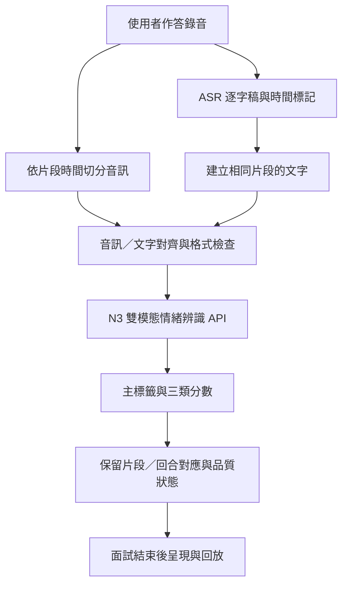

# 第二章　情緒辨識機制

結報架構與內容配置草案 v0.2｜2026-09-17｜條列式初版，供指導老師確認章節與預計內容

> 本稿不是最終研究成果或完整章節定稿。目的為先確認「章節怎麼分、各節要回答什麼、8 月企劃書哪些原文可移入、後續需要補哪些證據」。未完成實驗與尚未確認的系統行為不寫成已完成。
>
> 原文來源：[2026 年競賽企劃書](../../2026全國大專校院智慧創新暨跨域整合創作競賽企劃書12.pdf)，PDF 共 10 頁。下方頁碼以 PDF 第幾頁計，不是另編的結報頁碼。標示「原文沿用」的引文保留原句、數字與文獻編號，僅合併 PDF 排版斷行與非語意空白；疑義寫在引文之外，不暗中改寫。

## 給老師先看的章節總覽

本章建議採「任務 → 方法選用 → 資料 → 模型 → 訓練 → 推論 → 回饋 → 限制」的順序，讓讀者先知道辨識什麼，再理解如何訓練及如何用在面試系統。

- 第二章　情緒辨識機制
  - **2.1 辨識任務與系統需求**
    - 說明：台灣華語面試練習為什麼需要情緒訊號；定義興奮、不自信、中性，以及音訊＋文字輸入。
    - 初步放法：先放企劃書「逐句情緒感知」原段 P01，再補輸入／輸出與任務邊界。
    - 圖表：一張任務輸入、輸出與三類定義表。
  - **2.2 相關方法比較與選用理由**
    - 說明：文字、語音、雙模態方法的差別；為什麼選 Crab，以及為什麼需要中文適配。
    - 初步放法：方法比較 → 原選用理由 P02 → 原英文編碼器的中文限制 P03。
    - 圖表：一張方法比較表；尚未實測的比較只列特性，不填推測分數。
  - **2.3 資料來源、標籤定義與前處理**
    - 說明：MSP-Podcast、EmotionTalk、NNIME 的用途、三類映射、資料切分與前處理；最後介紹面試 TTS。
    - 初步放法：資料集原段 P04 → 映射原段 P05 → 各 split 數量與比例 → 完整／切段 TTS 的製作規則。
    - 圖表：來源與使用量表、映射與類別分布表；TTS 時長圖視篇幅放本節或結果章。
  - **2.4 雙模態模型架構與中文適配**
    - 說明：語音／文字編碼器、時序建模、跨模態融合與分類；區分原 Crab 架構及本組適配。
    - 初步放法：模型總圖 → 編碼器替換 P06 → 融合流程 P07 → 多層對比監督 P08 → LoRA 補充。
    - 圖表：優先沿用企劃書圖 1，核對中文編碼器、圖說與引用後再正式排版。
  - **2.5 訓練策略與實驗設計**
    - 說明：V1→N3 兩階段訓練、損失函數、超參數，以及 A／CL／多 seed／B 的研究問題。
    - 初步放法：兩階段原段 P09 → 獨立 warm-start 關係圖 → 固定配置與實驗變因 → macro-F1、Dev 選模及 Test 規則。
    - 圖表：一張訓練關係圖、一張超參數表、一張消融配置表；完整分數留給結果章。
  - **2.6 推論流程與系統整合**
    - 說明：使用者錄音如何經 ASR、片段對齊及 N3 API 產生結果，並處理長音訊與錯誤。
    - 初步放法：端到端流程圖 → API 輸入限制與輸出欄位 → 尚待確認的整合行為。
    - 圖表：一張推論流程圖；不能把 API 固定窗口直接寫成已完成語意逐句切分。
  - **2.7 辨識結果彙整與面試回饋**
    - 說明：片段、單次回答、整場面試如何呈現；回放與提示如何避免過度解讀。
    - 初步放法：面試後才呈現評語 P11 → 報告呈現 P12 → 彙整規則與回饋示例。
    - 圖表：一張回饋規則表；取得實際整合畫面後再放情緒時間軸／回放截圖。
  - **2.8 方法限制與適用條件**
    - 說明：三類映射不等於心理量測、領域與口音落差、ASR／切段誤差、TTS 未人工驗收、評估及授權限制。
    - 初步放法：先說適用情境，再列限制與影響，最後接未來改善方向。
    - 圖表：限制與影響表即可，不必額外製圖。

**初版閱讀方式：** 老師先看以上條列即可確認大架構；下方各節是「預計小節＋可搬入原文＋補寫／待確認」，尚不是完整定稿。現有檔案與圖表另集中於[情緒辨識結報素材清單](EMOTION_RECOGNITION_MATERIALS_INVENTORY.md)。

**與朋友原先六節的差別：** 保留原有主軸，但將「模型原理」與「服務推論」分開，並新增獨立的「訓練策略與實驗設計」。這樣比較容易看出本組做過的中文適配、資料處理與消融實驗，不會只像模型介紹或 API 使用手冊。

若老師要求仍維持六節，可把 2.5 合併至 2.4 的訓練小節、2.6 合併至同節的推論小節；但八節版本較清楚。

### 與其他章節的分工

| 內容 | 建議放置位置 |
|---|---|
| 問題背景、整體作品動機與市場調查 | 緒論；本章只保留情緒模組的需求 |
| 情緒辨識原理、資料、訓練方法、評估設計 | 以本章為主 |
| 完整分數、混淆矩陣、多 seed 表、消融結果與討論 | 若全書另有「實驗結果與討論」，集中放該章並回指 2.5 |
| 若全書沒有統一結果章 | 定稿時在本章 2.5 之後增列「實驗結果與分析」，後續節次順延；不是省略實驗結果 |
| 面試官角色、LLM 出題及評分規則 | 面試流程／多代理人章；2.7 只交代情緒訊號如何交付與使用 |
| API 部署指令、queue 續訓、GPU/RAM 限制、套件完整清單 | 系統實作章或附錄；不佔據本章的模型主線 |
| 面試官語音播放的 TTS 選型 | 語音互動章；與「用 TTS 擴增情緒訓練資料」分開 |

## 2.1　辨識任務與系統需求

### 預計小節

- 2.1.1 台灣華語面試練習的情緒資訊需求
- 2.1.2 三類辨識任務與輸入、輸出
- 2.1.3 情緒辨識與面試能力評分的責任邊界

**預計內容：** 說明文字逐字稿之外還需要觀察聲學線索；任務是對音訊片段及其對應文字輸出三類預測，不是直接量測人格、自信程度或錄取機率。中文為主要服務重點，英文模型可保留為歷史背景或延伸服務，不與中文結果混成一個分數。

**原文沿用 P01｜PDF 第 1 頁，「逐句情緒感知」：**

> 本模組架構採用 Crab 模型 [1]，由本團隊自行訓練權重並部署為本地端服務。系統對每一則回答進行逐句切分後輸出三類面試情緒（興奮／不自信／中性），藉此定位使用者自哪一句起展現不自信。相較於將整段回答歸納為單一標籤的作法，逐句判讀得以保留段內的情緒變化。

**原文之外的補寫／待確認：** 定稿前核對服務端切分究竟是 ASR 句段、語意句，還是固定時間窗口。若只是時間窗口，不可沿用原文便宣稱每個輸出必然對應完整句子；「展現不自信」的解讀也需加上操作型標籤的限制。

| 項目 | 本稿建議交代的定義 |
|---|---|
| 主要輸入 | 使用者作答音訊及與片段對應的逐字稿；不是面試官 TTS |
| 辨識單位 | 對齊後的語音／文字片段；服務實際切分方式待整合確認 |
| 模型標籤 | Excited、Unconfident、Neutral_3Class |
| 模型輸出 | 主標籤、三類 softmax 分數、主類別分數、模型版本等 |
| 應用端補充 | 片段起訖時間、回合 ID、回放關聯與品質狀態；需核對實際後端 |
| 不直接輸出 | 心理自信量表分數、人格診斷、是否誠實、是否適任或錄取結論 |

## 2.2　相關方法比較與選用理由

### 預計小節

- 2.2.1 文字、語音與雙模態方法的比較面向
- 2.2.2 Crab 的選用背景
- 2.2.3 原模型在中文應用上的問題

**原文沿用 P02｜PDF 第 5 頁，「架構來源」：**

> 本系統情緒辨識模組之模型架構採用已發表之 Crab 模型 [1]。
>
> 在技術調研時（2026 年 3 月）比較各語音情緒辨識模型在 MSP-Podcast 上之表現，Crab 為當時該資料集上成績最佳者。

**原文沿用 P03｜PDF 第 4 頁，「原架構之語言限制」：**

> Crab [1] 原研究之三個評測資料集皆為英文語料，其語音與文字編碼器(encoder)亦僅在英文條件下驗證。文字側與語音側所採用的 RoBERTa 和 WavLM 直接套用於中文面試語音時，能力明顯不足。實測顯示，以原架構之編碼器(encoder)組合在相同中文語料上訓練後，『不自信』 F1 僅 0.320，為三類中最低，而該類正是面試回饋中最需要準確判讀的目標。

**補寫方式：** 用一張比較表列「輸入模態、目標語言、所需標註、推論資源、可保留的資訊、本組有無實測」。沒有做過對照實驗的列，寫成方法特性／選型考量，不補造分數或宣稱雙模態已在本組實驗中必然勝出。

**待查證，不在本稿擅改原文：** P02「成績最佳」需要補原始比較來源、資料 split、指標與比較時間；P03 的 0.320 需要追到 run／split／模型設定，不能和其他設定的 0.403 或 0.482 直接串成同一條改善曲線。若證據不足，定稿時再另議文字修正。

## 2.3　資料來源、標籤定義與前處理

### 預計小節

- 2.3.1 真人語料來源與版本
- 2.3.2 三類映射與操作型定義
- 2.3.3 Train／Development／Test 切分與前處理
- 2.3.4 面試情境 TTS 擴增資料與品質限制

**原文沿用 P04｜PDF 第 2 頁，「語音情緒辨識」中的語料介紹：**

> MSP-Podcast [2] 為本作品英文情緒模型之訓練語料。該研究提出自既有 Podcast 錄音中檢索情緒語音以建構大規模語料庫的方法，樣本取自真實對話而非演員表演，情緒分布亦較為均衡，適用於面試此類非表演性語音之判讀情境。
>
> NNIME [3] 為本作品中文情緒模型之訓練語料。該語料庫收錄 44 位受試者之即興雙人互動，同步記錄語音、影像與生理訊號，為中文自然互動情緒研究之重要資源，亦為少數具備足夠規模之繁體中文情境語料。
>
> EmotionTalk [4] 為本作品中文情緒模型之訓練語料。該語料庫收錄 19 位受試者之雙人互動，共 23.6 小時、19,250 句，同步提供聲學、影像與文字三種模態，並具備七類情緒、五級情感傾向與四維語音描述等多層次標註。

**原文沿用 P05｜PDF 第 5 頁，「三類面試情緒」：**

> 三類面試情緒: 原始語料採用八類通用情緒標註，其分類目的為描述一般情感狀態，與面試回饋所需的判讀維度並不一致。在內部討論以及調研後，將八類標註映射為三類面試情緒：興奮、不自信、中性，使模型輸出可直接對應面試者的表現特徵，並同時緩解原始語料中少數類別樣本過少的問題。

**本節後續應補的表格：**

| 表格 | 必填欄位／要防止的誤解 |
|---|---|
| 資料來源表 | 資料版本、語言／口音、互動或表演形式、授權、原始規模、實際使用筆數；兩種規模不能混寫 |
| 三類映射表 | 逐資料集列原始標籤→E/U/N／排除規則；不能把所有資料集都當成同一種八類標註 |
| 映射後分布表 | 每個 split 的三類筆數、比例及時長統計；比例分母寫清楚 |
| 前處理表 | 取樣率／聲道、Train 統計、長度上限、文字 tokenizer／token 上限、排除規則 |
| TTS 版本表 | 生成來源、音色、文本來源、完整／切段版本、parent關係、人工驗收狀態、僅Train用途 |

現有內部紀錄可作為填表起點：V1 使用 MSP-Podcast 30,000 筆與 EmotionTalk 11,744 筆；N3 stage 2 真人 NNIME 為 Train 3,054／Dev 608／Test 638。定稿仍須綁定實際 manifest 與資料版本，不把這些使用筆數寫成資料庫官方總規模。

**需明確寫出的邊界：** 資料庫提供影像、生理訊號，不表示本模型使用那些模態；本章的模型是音訊＋文字。三類映射是本專題的任務定義，特別是 Unconfident 並非直接取得的心理自信真值。原始三類不平衡是否改善應以映射後統計支持。

TTS 全為 Train-only，不混入真人 Dev/Test。同一 parent 的完整語音與切段語音視為相關來源。現有 A/B 為未完成人工情緒／逐字稿驗收的探索性實驗，不能寫成「全部通過人工標註」。此處的 TTS 資料擴增與面試官語音播放服務是兩個不同用途。

## 2.4　雙模態模型架構與中文適配

### 預計小節

- 2.4.1 語音與文字編碼器
- 2.4.2 時序建模與跨模態融合
- 2.4.3 三類分類輸出
- 2.4.4 參數高效率微調與多層對比監督

**原文沿用 P06｜PDF 第 4 頁，「自行訓練與中文延伸」：**

> 編碼器(encoder)跨語言替換: 語音側改用 wav2vec2-XLS-R-300M、文字側改用 XLM-RoBERTa-Large，取代原架構之 WavLM 與 RoBERTa，提升模型在中文的辨識能力。

**原文沿用 P07｜PDF 第 5–6 頁，「情緒辨識模型之架構調整」的融合段落：**

> 跨模態融合部分維持原架構設計：語音與文字兩側各經線性投影與雙向 GRU 建模時序後，以跨模態注意力雙向對齊（語音查詢文字、文字查詢語音），殘差相加、注意力池化、串接後進分類頭。

**原文沿用 P08｜PDF 第 2 頁，「語音情緒辨識」：**

> Crab [1] 為雙模態跨模態 Transformer 架構，核心是多層對比監督：在網路的多個層次注入對比學習訊號，而非只在最後的分類層施加監督，藉此提升中間表徵的鑑別力，且推論時不增加參數。

**預計補寫：** 說清楚每個組件的作用；LoRA 是如何微調編碼器，而不是重新從零訓練整個基礎模型。多層對比損失是訓練監督，不能畫成推論時仍需要真實情緒標籤的程序。「推論不增加參數」須限定是對比監督本身，不泛指整個中文模型或 API 沒有額外成本。

**圖的沿用：** 企劃書 PDF 第 4 頁圖 1 可作模型圖候選，先保留原圖。正式排版時另行改圖號與圖說，核對圖中文字與最終模型是否一致，標明「依 Crab 架構改繪，本組替換編碼器並微調」，不暗示 Crab 架構為本組首創。本稿不修改 PDF 或原圖。

## 2.5　訓練策略與實驗設計

### 預計小節

- 2.5.1 中英混合 V1 與中文 N3 的兩階段訓練
- 2.5.2 損失函數與訓練配置
- 2.5.3 TTS 擴增、時長匹配與對比損失消融
- 2.5.4 評估指標、選模與重現原則

**原文沿用 P09｜PDF 第 5 頁，「兩階段遷移訓練」：**

> 兩階段遷移訓練: 先於中英混合語料上建立雙語骨幹，再以 NNIME [3]完成第二階段微調。實測顯示中英混合訓練所得之骨幹，效能優於以更大量純英文資料訓練者，跨語言混合訓練於此具有正則化的作用。

**需另外標註：** 「具有正則化的作用」是原企劃書的解釋，單靠分數提升還不能確立因果；定稿前補對照配置，或經團隊同意後把原因改寫為推測。N3 是實驗版本名稱，應先定義，不把 N3、V1、stage 2、scheme 1 混成同一概念。

```text
V1：中英混合真人資料訓練
            │ 相同初始化權重
            ├─ 原 N3：NNIME 真人 Train
            ├─ A：NNIME 真人 Train＋完整 U TTS
            ├─ CL：固定 A25，改變對比損失權重
            └─ B：NNIME 真人 Train＋長度匹配 U TTS

每個實驗獨立 warm-start；不是 A25 訓練完再接著做 A50。
```

| 實驗軸 | 預計交代什麼 | 本稿的狀態界線 |
|---|---|---|
| 原 N3 基線 | V1 初始化、NNIME stage 2、固定評估集 | 保留為歷史基線；是否加同環境重訓基線另記 |
| A 完整 U TTS | 以真人 Train U=628 為分母，新增25/50/75%，即157/314/471筆 | 已有探索結果；不是 TTS 占混合資料的25/50/75% |
| CL 消融 | 固定A25，比較 λ=0/1/2/3 | 只改 stage 2 的 λ；λ=0 不會消除 V1 的既有對比學習歷史 |
| A 多 seed | 3劑量×seeds42/43/44 | 平均、標準差及單次結果分列；不只報最高一次 |
| B 時長匹配 | 與A對應parent及筆數，參考NNIME Train U≥1秒分布 | 目前只有seed42；排除<1秒是合成匹配規則，不是刪除真人Train |
| 後續補 E／N 等 | 補充興奮或中性資料的研究問題 | 尚未凍結者放未來工作，不先寫成完成實驗 |

本節介紹 weighted CE 與多層對比 loss 的組成，並提供一張超參數表。macro-F1 為主要指標，另列各類 precision/recall/F1、UAR、混淆矩陣；Dev 用於選模，Test 作保留評估。macro-F1 的拼字統一，不寫 marco-F1。

歷史 A/CL 的 patience5 與後續 full10/patience0 要分清楚；micro-batch 4、gradient accumulation 4 不代表對比損失每次可看到16筆。完整 run 清單、seed、最佳epoch及結果移至結果章或附表，避免在方法段落邊介紹邊挑最高分。

**原文沿用 P10｜PDF 第 5 頁，「訓練結果」；建議保留於歷史結果材料，不直接當本章最終結論：**

> 目前中文模型於 NNIME 測試集之 macro-F1 達 0.5877。三類之中以「不自信」改善幅度最大，F1 自 0.403 提升至 0.482。後續將持續提升模型在臺灣口音上的情緒辨識能力。

這裡的「目前」指8月企劃書當時。定稿時用一張結果表標明日期／版本，不默默將原數字替換為後續最高值；「65%以上」仍是研究目標而不是成果。後續探索結果以既有 RESULTS.md 及原始 run 紀錄為來源，本架構稿不另產生一份會分歧的排行榜。

## 2.6　推論流程與系統整合

### 預計小節

- 2.6.1 作答錄音、ASR 與語音文字對齊
- 2.6.2 片段分類與 API 輸出
- 2.6.3 長音訊、錯誤處理與服務邊界

以下是**待以實際整合程式核對的章節流程圖**，不是宣稱所有服務功能已經驗收：



**現有 API 文件可支撐的項目：** 單筆／batch／long 入口、模型 ID、三類 softmax、`primary_label`、`primary_confidence`、音訊長度與延遲欄位。單筆上限12秒、文字128 tokens；服務端超限拒絕與訓練時截長是不同規則，不能合寫成「任何輸入一律自動截斷」。

**需與系統負責人確認：** 正式後端實際使用哪一個入口、ASR timestamp 精度、過長句如何拆分、是否每段都有正確文字、錯誤／逾時如何顯示。API 的 fixed sliding windows 不等於語意逐句切分。離線NNIME使用資料集逐字稿的成績，也不等於線上ASR整條流程的成績。

## 2.7　辨識結果彙整與面試回饋

### 預計小節

- 2.7.1 片段、回合與整場面試的呈現層級
- 2.7.2 情緒變化的定位與錄音回放
- 2.7.3 回饋規則與不可靠結果的處理

**原文沿用 P11｜PDF 第 1 頁，「模擬真實面試的功能設計」：**

> 本系統不在模擬面試期間顯示即時分數與評語，刻意限縮資訊揭露，使互動回歸「僅有使用者與面試官對談」之真實條件；所有評估資訊統一保留至面試結束後之檢討階段呈現。

**原文沿用 P12｜PDF 第 6 頁，「面試結果報告的高互動與高效」：**

> 成果報告將各項評分指標清晰分隔，並搭配互動式走勢圖設計。使用者無需頻繁翻頁，只需在固定視窗中透過最少的滑鼠操作，就能輕鬆掌握最全面、最精準的自我表現數據。

P11/P12 是介面與回饋設計文字，不是辨識準確度驗證；「最精準」不能拿來當模型成效結論。

| 層級 | 預計寫的內容 | 定稿前待確認 |
|---|---|---|
| 片段 | 哪段音訊被預測為哪一類，保留原句、時間與回放入口 | ID／時間如何由後端關聯；API 本身不代表已有完整回饋頁 |
| 單次回答 | 是否顯示片段分布、時間軸或整段摘要 | 依筆數比例或有效時長？用硬標籤或平均機率？不可混稱 |
| 整場面試 | 各回合的情緒表現變化，與面試官評語並列 | 失敗片段、重疊窗口、不同回答長度如何處理 |
| 提示文字 | 指向可回聽的片段，提供練習參考 | 不把模型預測寫成「你缺乏自信」的定論；是否有人審／使用者修正 |
| 低可靠度 | 可標示無法判讀／資料不足，避免硬猜或默認中性 | 門檻須另以Dev或服務驗證資料決定，不在本稿任意填數值 |

**重要區別：** `primary_confidence` 是模型對預測類別的分數，不是使用者的「自信程度」，也不是已校準的正確率。情緒預測不應直接換算成面試能力分數；如系統確實有加權規則，需在此明示其設計依據、版本與驗證，不自行杜撰公式。

## 2.8　方法限制與適用條件

這一節不宜只寫「資料不足」或「準確率仍可提升」，應交代結果該如何被正確使用。

| 限制 | 預計寫法／對使用情境的影響 |
|---|---|
| 標籤代理性 | 三類是本專題重新映射的操作型標籤；悲傷、恐懼等不能無條件等同心理不自信 |
| 語料與面試的領域差異 | 台灣互動語料較接近目標口音，不等於已經驗證真實面試、所有台灣口音與中英夾雜 |
| 片段與ASR誤差 | 太短、切掉猶豫／語尾或文字不對齊，可能失去情緒線索；仍需證據，不能直接斷言這就是B組結果的原因 |
| 合成資料品質 | 生成指令為U不等於實際聲音確實為U；未人工驗收、音色集中、文本主題與類別綁定可能形成偏差 |
| 評估可比性 | 不同seed／early-stop政策／split分開；未做配對Test不能借用別組Test代替 |
| 模型與回饋解讀 | 分類分數未校準、非心理測量；只能提供輔助練習線索，不作招聘篩選或診斷依據 |
| 資料授權與隱私 | NNIME依取得之學術授權使用；不公開原音檔或逐字稿；服務錄音的同意、存取、保存與刪除政策待系統端確認 |
| 工程邊界 | 離線辨識、API驗證、正式系統部署與queue續訓是不同驗證層次，不互相替代 |

## 原企劃書段落搬移索引

| 原文ID | 原 PDF 位置 | 建議新位置 | 搬移／核對說明 |
|---|---|---|---|
| P01 | p.1／逐句情緒感知 | 2.1 | 任務介紹；逐句與窗口的實作語意待核對 |
| P02 | p.5／架構來源 | 2.2 | 保留選型背景；最佳成績主張待查證 |
| P03 | p.4／原架構之語言限制 | 2.2 | 數字先保留；需補run與split |
| P04 | p.2／三個資料集介紹 | 2.3 | 區分官方規模、資料版本與實際使用量 |
| P05 | p.5／三類面試情緒 | 2.3 | 後接逐資料集映射表與操作型定義 |
| P06 | p.4／跨語言編碼器替換 | 2.4 | 呈現本組中文適配工作 |
| P07 | p.5–6／融合架構 | 2.4 | 接模型圖及各組件解釋 |
| P08 | p.2／Crab多層對比監督 | 2.4 | 理論與架構；loss設定放2.5 |
| P09 | p.5／兩階段遷移訓練 | 2.5 | 加版本路線圖；因果解釋待確認 |
| P10 | p.5／訓練結果 | 結果章或本章結果小節 | 8月歷史結果，不覆蓋為最新最高值 |
| P11 | p.1／不即時呈現評語 | 2.7 | 回饋時機與UX，不是模型成效 |
| P12 | p.6／結果報告呈現 | 2.7 | 保留介面描述，與效度主張區分 |

未搬入多代理人、面試官TTS選型、競賽工作時程與軟體授權全文，因為它們不屬於本章情緒辨識主線。整體系統圖2與UI圖3–5可跨章引用；不必在本章重複放所有介面截圖。

## 建議圖表清單（先定用途，不急著全部製圖）

| 編號暫訂 | 名稱 | 資料／來源 |
|---|---|---|
| 圖2-1 | 中文雙模態情緒辨識模型 | 沿用企劃書圖1，定稿核對圖說／編碼器／引用 |
| 圖2-2 | V1→N3與A／CL／B的訓練關係 | 本稿2.5；以相同起點分支，不畫成依序續訓 |
| 圖2-3 | 作答錄音到逐片段回饋的推論流程 | 本稿2.6；需系統整合人員確認 |
| 表2-1 | 任務輸入／輸出與三類定義 | 2.1、現有API schema |
| 表2-2 | 方法比較與選用依據 | 2.2；不填未實測分數 |
| 表2-3 | 資料來源、用途、版本與split數量 | 2.3；以凍結manifest為準 |
| 表2-4 | 原始標籤映射及三類比例 | 2.3；按資料集與split列示 |
| 表2-5 | 核心超參數與實驗變因 | 2.5；區分歷史與後續配置 |
| 表2-6 | 辨識結果彙整／回饋規則 | 2.7；未確認項維持待定 |

以上是圖表用途清單，不是最終編號；結果圖表另依全書章節編排。LoRA、XLS-R、XLM-R若要在正式稿解釋原理，需補各自原始論文引用，而不是全部只引用Crab。

## 引用、證據與待辦

### 從企劃書保留的文獻（尚未重新外部校對）

[1] L. H. Ueda, J. G. T. Lima, and P. D. P. Costa, "Crab: Multi Layer Contrastive Supervision to Improve Speech Emotion Recognition Under Both Acted and Natural Speech Condition," arXiv preprint arXiv:2603.23673, 2026.

[2] R. Lotfian and C. Busso, "Building Naturalistic Emotionally Balanced Speech Corpus by Retrieving Emotional Speech from Existing Podcast Recordings," IEEE Trans. Affective Computing, vol. 10, no. 4, pp. 471–483, Oct.–Dec. 2019.

[3] H.-C. Chou, W.-C. Lin, L.-C. Chang, C.-C. Li, H.-P. Ma, and C.-C. Lee, "NNIME: The NTHU-NTUA Chinese Interactive Multimodal Emotion Corpus," in Proc. 7th Int. Conf. Affective Computing and Intelligent Interaction (ACII), 2017, pp. 292–298.

[4] H. Sun et al., "EmotionTalk: An Interactive Chinese Multimodal Emotion Dataset With Rich Annotations," arXiv preprint arXiv:2505.23018, 2025.

本稿沿用使用者提供文件的引用，不宣稱已重新查核論文版本、官方規模或當時排行榜。定稿時統一參考文獻編號，原引文中的[1]–[4]也一起更新；來源存檔可保留原編號。

### 內部證據入口

- [資料處理與驗收](../n3_tts/DATASET_AND_REVIEW.md)：TTS版本、時長匹配及人工驗收狀態。
- [訓練計畫](../n3_tts/TRAINING_PLAN.md)：V1／N3、loss、超參數、各消融因子。
- [實驗結果](../n3_tts/RESULTS.md)：已記錄的Dev／Test、seed、適用比較與限制。
- [API規格](../../api/N3_API.md)、[schema](../../api/schemas.py)：模型身分、輸入限制與輸出欄位。
- [融合模型程式](../../src/models/ser.py)：定稿核對模型圖與實作。
- [資料集整理](../../BILINGUAL_DATASETS.md)：映射的歷史決策；最終仍以實驗manifest為準。

### 老師確認架構後，再依序補齊

1. 確認採八節架構、以及全書是否另設實驗結果章。
2. 保留本稿原文引文版本；對需修正的數字／論述另外列修訂稿，經確認後才替換。
3. 逐資料集凍結使用量、三類映射、split與授權說明。
4. 與系統端確認逐句切分、時間對齊、彙整方式和回饋責任；未確認項不自行補門檻。
5. 實驗結束後再補最終表格、選模依據及限制；保留未達預期與負向結果。
6. 最後統一圖表、文獻、模型命名、頁碼及「已完成／探索性／未來工作」的時態。

**本次產物：** 本機結報架構草案與另一份素材清單；未修改原PDF、既有實驗、模型或系統程式，未提交Git或推送。
